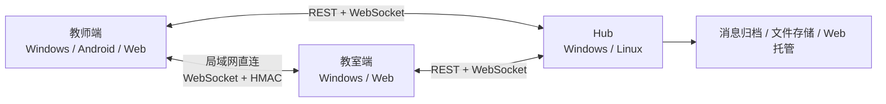

# 校联 SchoolLink

校园局域网通知与文件分发系统，使用 Flutter 构建 Windows / Android / Web 三端，配套纯 Dart Hub。

教师可以发送全屏通知、文件和普通消息；教室大屏自动接收文件、集中留存通知历史，普通聊天和教室回复不会触发全屏。

[官网](https://lihongbo-learn.github.io/SchoolLink/) · [下载 Releases](https://github.com/Lihongbo-Learn/SchoolLink/releases) · [问题反馈](https://github.com/Lihongbo-Learn/SchoolLink/issues)

> 当前版本：`0.2.0 开发预览`。功能和接口仍可能变化。

## 特性

- **教室端**：首次选择年级（高一/高二/高三）与班级（9–16 班）后锁定；接收全屏通知，自动保存教师文件，按老师查看会话和通知历史。
- **教师端**：姓名 + PIN 登录，只显示任教班级；支持单班或全部任教班级发送普通消息、全屏通知和文件。
- **通知与聊天分离**：只有通知触发全屏。教师可在发送时逐条选择手动确认或 N 秒自动关闭，并决定是否播放提示音。
- **混合网络**：原生端优先通过局域网直连传递消息，同时向 Hub 归档；直连不可用时自动走 Hub，重连后补齐历史。
- **Hub**：纯 Dart 服务，负责账号、花名册、消息、文件、离线同步和 Web 托管，内置管理台。
- **Windows 桌面体验**：系统托盘、关闭到托盘、自绘无边框标题栏、启动时自动检查防火墙。
- **开源可自部署**：MIT License，无云服务依赖，数据和文件保存在自己的 Hub。

## 架构



- 原生端支持直连优先，Web 端受浏览器限制，始终通过 Hub。
- Hub 是常开电脑上的单进程服务，数据默认保存在本机目录，文件默认保留 90 天（可配置）。
- 端口：`8421/TCP`（HTTP/WebSocket/Web）、`8421/UDP`（Hub 发现）、`8422/TCP`（原生直连）、`8424/UDP`（直连发现）。

## 快速开始

### 环境

- Flutter 3.47+ / Dart 3.13+
- Windows 桌面构建需要 Visual Studio（含“使用 C++ 的桌面开发”）
- Android 构建需要 Android SDK、NDK 和 Java 17+
- Windows 打包需要 [Inno Setup 6](https://jrsoftware.org/isinfo.php)（可用 `ISCC_PATH` 指定路径）

### 1. 启动 Hub（开发）

先构建 Web 产物（Hub 会把它托管给浏览器）：

```bash
cd apps/app
flutter pub get
flutter build web --release --no-web-resources-cdn
```

再启动 Hub：

```bash
cd ../../packages/hub
dart pub get
dart run bin/server.dart \
  --port 8421 \
  --data ../../data \
  --web-root ../../apps/app/build/web
```

浏览器打开 `http://<Hub 主机 IP>:8421/`。默认管理员 PIN 为 `246810`，学校注册码为 `SCHOOL26`；首次部署后请在管理台修改。

### 2. 运行桌面/移动端

```bash
cd apps/app
flutter pub get
flutter run -d windows
# 或连接 Android 设备后
flutter run -d android
```

多开 Windows 客户端调试时可使用独立 profile：

```powershell
school_link.exe --profile=classroom
school_link.exe --profile=teacher
```

### 3. 构建与打包

```bash
cd apps/app
flutter build windows --release
flutter build apk --release
flutter build web --release --no-web-resources-cdn
```

一键打包（Windows，产物在 `dist/`）：

```powershell
pwsh tools/package.ps1
# 已有构建产物时只重新打包：
pwsh tools/package.ps1 -SkipBuild
```

Android 发布签名：在 `apps/app/android/key.properties` 中配置自己的 keystore。该文件和 `*.jks` 已被 `.gitignore` 排除，请勿提交。没有签名配置时，release 构建会回退到调试签名。

## 部署到学校

### Windows Hub

在交付目录或安装后的应用中运行：

```powershell
SchoolLinkHub.exe --port 8421 --data "%LOCALAPPDATA%\SchoolLinkHub" --web-root ".\web"
```

可以使用任务计划程序设置开机启动。Hub 在 Windows 启动时会自动检查防火墙；缺少规则时会发起一次 UAC，申请添加 **仅限本地子网** 的放行规则。也可以用管理员 PowerShell 手动执行：

```powershell
powershell -ExecutionPolicy Bypass -File tools/enable-firewall.ps1
```

### Linux Hub

```bash
tar -xzf SchoolLinkHub-linux.tar.gz
cd SchoolLinkHub-linux
sudo bash install.sh
```

脚本会创建 `schoollink` 用户、安装或从源码编译 Hub、配置 systemd 开机自启，并在检测到 ufw/firewalld 时放行端口。数据保存在 `/var/lib/schoollink-hub`。

### 教室 Web 端

```text
msedge --kiosk --app=http://<Hub 主机 IP>:8421/
```

Web 端作为辅助方案使用；Windows 教室客户端支持直连、托盘和更完整的大屏能力。

## 目录

```text
apps/app                 Flutter 三端应用
packages/protocol        共享协议、消息模型、PIN 哈希与 HMAC
packages/hub             Hub 服务端（shelf + sembast + 文件存储）
installer                Inno Setup 与 Linux 一键安装脚本
tools                    构建、打包、防火墙脚本
docs                     官网（GitHub Pages）
```

## 测试

```bash
cd packages/hub
dart test

cd ../../apps/app
flutter analyze
flutter test
```

Hub 测试覆盖账号、聊天、通知、去重、文件和管理台；应用测试覆盖启动页与双 Peer 发现/握手/HMAC 消息。

## 安全与限制

- 本项目面向校园局域网设计，Hub 使用 HTTP，不提供公网 TLS；不要把端口直接映射到公网。
- 部署后请立即修改默认管理员 PIN 和注册码，并只把注册码发给校内教师。
- 教室模式锁定存储在本地；清除应用数据或卸载重装才能重置。
- Android 后台保活受系统限制，教室端请保持前台。
- Linux 一键安装脚本已在 bash 语法层验证；不同发行版的 systemd/防火墙差异仍需在实际服务器上确认。
- Hub 文件默认保留 90 天；请定期备份 Hub 数据目录。
- Android 客户端目前没有扫码配对，首次连接使用手动 Hub 地址。

## License

[MIT](LICENSE) © 2026 SchoolLink contributors
